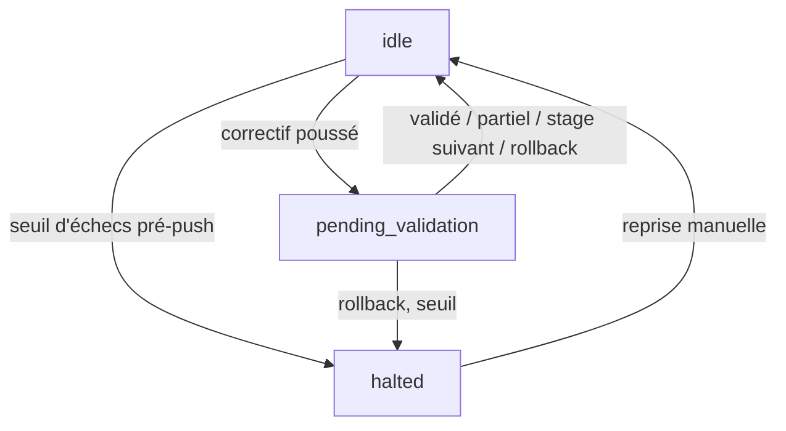
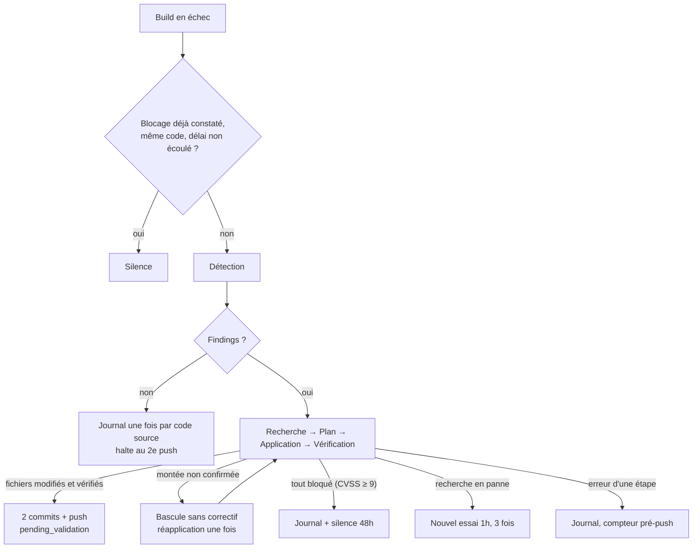

# Remédiation CVE automatisée (fixcve-auto)

Automatisation complète de la remédiation des CVE bloquantes détectées par Trivy ou OWASP Dependency-Check dans le pipeline `RHDemo-CI`, **sans validation humaine**. Elle tourne dans Jenkins (job `RHDemo-FixCVE`) depuis le 2026-11-22 ; elle était auparavant lancée par un cron du poste ([ETUDE_FIXCVE_DANS_JENKINS.md](ETUDE_FIXCVE_DANS_JENKINS.md)). La procédure est **entièrement déterministe** (aucun LLM) depuis la refonte du 2026-10-09 (voir [FIXCVE_AUTO_REFONTE.md](FIXCVE_AUTO_REFONTE.md), section 10). Le skill interactif `/fixcve` réutilise les mêmes scripts avec validation humaine.

**Objectif mesuré** : un cycle n'échoue que face à une CVE **sans correctif publié, CVSS ≥ 9 et sans critère A** (« échec conforme »). Tout autre échec est un défaut de la procédure, compté par l'indicateur `fixcve-stats.py` (voir « Indicateur »).

---

## Architecture

```text
RHDemo-CI ── post { always } ──> job RHDemo-FixCVE (Jenkinsfile-FixCVE, agent « fixcve »)
cron de secours horaire ────────┘   └─> fixcve-state.sh (action d'exploitation)
                                          └─> fixcve-auto-poll.sh (checkout neuf, branche du job)
         │
         ├─ Phase A (idle) : nouveau build Jenkins en échec sur un stage Trivy/OWASP
         │     1. fixcve-detect.py    -> detected.json   rapports Jenkins -> findings
         │     2. fixcve-resolve.py   -> lookup.json     avis OSV + registres -> version corrigée
         │     3. fixcve-classify.py  -> plan.json       politique : upgrade / A / B / blocage
         │     5. fixcve-apply.py     -> fichiers modifiés + événements d'audit préparés
         │     6. fixcve-verify.py    -> vérification locale (syntaxe, npm, Dependency-Check)
         │     7. commit du correctif, commit du journal, push
         │     (validation de schéma entre 1, 2 et 3 ; tout échec arrête le cycle avant push)
         │
         └─ Phase B (pending_validation) : build CI suivant, bâti sur le correctif
               ├─ SUCCESS → validé
               ├─ FAILURE, findings traités disparus, aucun nouveau → validation partielle
               ├─ FAILURE, stage d'origine propre, échec sur le scan suivant → validé, stage suivant traité
               └─ sinon → git revert du correctif + halte après 2 rollbacks consécutifs
```

Tout le code est dans [`rhDemo/scripts/`](../scripts/) : les points d'entrée `fixcve-*.py` et la bibliothèque [`fixcve_lib/`](../scripts/fixcve_lib/__init__.py) (un module par responsabilité, décrits dans son `__init__.py`).

### Étapes et sources de vérité

| Étape | Script | Source de vérité | Sortie |
| --- | --- | --- | --- |
| 1. Détection | `fixcve-detect.py` | Rapports Jenkins (HTML OWASP DC, JSON Trivy) | `detected.json` |
| 2. Recherche | `fixcve-resolve.py` (`fixcve_lib/resolve.py`) | **Avis OSV.dev** (plage corrigée par branche, alias CVE ↔ GHSA), confirmé par le registre (Maven Central, npm, quay.io / Docker Hub / ghcr.io) ; `npm audit`, `package-lock.json`, `mvnw dependency:list` | `lookup.json` |
| 3. Classification | `fixcve-classify.py` (`fixcve_lib/policy.py`) | Table de décision ci-dessous | `plan.json` |
| 5. Application | `fixcve-apply.py` (`apply.py`, `edits.py`, `suppressions.py`, `advisories.py`) | Plan validé | fichiers de remédiation, `apply-result.json` |
| 6. Vérification | `fixcve-verify.py` (`verify.py`) | Parseurs XML/YAML/JSON, lockfile, `npm audit`, rescan Dependency-Check local | `verify.json` |

Les fichiers de cycle vivent dans `rhDemo/.fixcve-cycle/` de l'espace de travail et sont archivés dans le volume d'état, `cycle/archive/<build>-<étape>.json` (post-mortem, rejeu en test).

### Table de décision (étape 3)

| Situation | Action | Résultat |
| --- | --- | --- |
| Version corrigée publiée dans la **même branche majeure** | `upgrade` | `fixed` |
| Recherche en panne (OSV et registre injoignables) | `transient` : rien n'est supprimé, nouvel essai dans 1 h (3 fois, puis 48 h et alerte) | `transient` |
| Sans correctif, **critère A** vérifié | `suppress_permanent` | `accepted_permanent` |
| Sans correctif, CVSS < 9.0 | `suppress_temporary` (**critère B**, jeton `[PENDING_UPSTREAM_FIX]`) | `accepted_temporary` |
| Sans correctif, CVSS ≥ 9.0, sans critère A | `blocked`, journalisé, revue humaine | `blocked_no_fix_ge9` (échec conforme) |

**Critère A** (inexposition objective, prime sur le CVSS) : paquet npm dont toutes les copies sont `dev` dans `package-lock.json` ; dépendance Maven du projet dont toutes les portées sont `test`/`provided` ; vecteur CVSS `AV:L`/`AV:P`. Un jugement contextuel (code vulnérable non atteint dans notre configuration) n'est **jamais** automatique : c'est une décision humaine (skill `/fixcve`, critère `A:decision_humaine`).

Une montée qui ne peut pas être appliquée ou que la vérification ne confirme pas retombe **une fois** dans la branche « sans correctif » de la table (A, B ou blocage) ; le plan est réappliqué et revérifié.

### Montées de version (étape 5)

- **npm** : `npm update <paquet> --package-lock-only` ; à défaut `npm install` exact (dépendance directe) ou `overrides` (transitive). Retenue seulement si **toutes** les copies du lockfile atteignent la cible ; sinon fichiers restaurés (incident #845/#847, montée sans effet).
- **Maven** : propriété du BOM Spring Boot qui gère l'artefact (lue dans `spring-boot-dependencies` de `~/.m2`, BOM importé compris, ex. `jackson-2-bom.version`), commentaire `<!-- Fix ... -->`. Artefact non géré par le BOM : pas de montée (retombe en suppression A/B ou blocage).
- **Image tierce** (jar embarqué : Keycloak, nginx, postgres, NGF) : tag candidat issu des versions corrigées annoncées par Trivy, avec le suffixe de variante du tag courant, plus récent que lui, digest lu sur le registre ; référence `dépôt:tag@digest` remplacée dans `Jenkinsfile-CI`, les deux `docker-compose.yml`, `values.yaml` et `init-stagingkub.sh`. Un numéro de bibliothèque (bcprov 1.85) n'est jamais un tag : décision humaine.
- **Paquet système d'image** : aucun tag corrigé déductible sans scanner l'image ; suppression A/B ou blocage selon la table.

### Suppressions (étape 5, `suppressions.py`)

Générées, jamais rédigées : toutes les formes connues de la faille (`<cve>` pour un CVE, `<vulnerabilityName>` pour un GHSA : OSS Index nomme par CVE, Node Audit par GHSA, voir [OWASP_DEPENDENCY_CHECK.md](OWASP_DEPENDENCY_CHECK.md)) ; formes manquantes ajoutées au bloc existant ; portée `groupId` entier pour les groupes à CPE générique (tomcat, log4j, spring-security, jackson...) ; justification dans `<notes>`, jamais en commentaire XML. Trivy : entrée `.trivyignore.yaml` avec jeton `[OSV:<DISTRO>:<branche>]` pour un paquet système.

**Clôture automatique** des suppressions temporaires : à chaque cycle, les blocs `[PENDING_UPSTREAM_FIX]` npm et Maven sont revérifiés (avis OSV + registre) ; si un correctif est publié, toutes les formes de la faille sont retirées et la montée appliquée (événement `pending_fix_resolved`). Les suppressions Trivy (composants d'images tierces) restent à revérifier manuellement (la console du job les liste) ; pour un paquet système portant le jeton `[OSV:<DISTRO>:<branche>]`, l'avis de distribution OSV (`ALPINE-<CVE>`, `DEBIAN-<CVE>`, `UBUNTU-<CVE>`) est lu et une ligne `ALERTE` est écrite si la branche installée a un correctif, dans la console du job, avec un mail (build `UNSTABLE`), à chaque cycle tant que la suppression reste en place ; rien dans le journal d'audit. Aucune action automatique : un correctif de distribution ne prouve pas qu'une image tierce l'embarque. Cette revérification n'a lieu que dans un cycle déclenché par un build en échec.

---

## Garde-fous

| Garde-fou | Détail |
| --- | --- |
| **Aucun LLM** | Plus aucune surface d'injection de prompt : les rapports et avis externes ne sont lus que par du code ; aucun secret n'est exposé à un modèle. Les textes libres externes (titres de CVE) ne sont jamais recopiés dans un fichier versionné. |
| **Pas d'épinglage des scripts** | Comme `Jenkinsfile-CI` et `Jenkinsfile-Renovate`, `Jenkinsfile-FixCVE` et les scripts sont lus sur la branche : un compte qui pousse peut modifier le bot (risque accepté le 2026-11-22, [ETUDE_FIXCVE_DANS_JENKINS.md](ETUDE_FIXCVE_DANS_JENKINS.md), T1). |
| **Checkout neuf à chaque passage** | Espace de travail jetable de l'agent, placé sur `origin/<branche du job>` à jour : jamais d'arbre sale hérité d'un cycle interrompu. |
| **Push refusé** | origin a avancé pendant le cycle (merge Renovate) : si tous les commits locaux sont ceux du bot, rebase sur origin puis push (`scripts/fixcve-git-sync.sh`) ; sinon ou en cas de conflit, échec du passage sans mise à jour de l'état, le suivant recommence. |
| **Revert limité aux commits du bot** | Le rollback n'annule qu'un commit dont l'auteur est `RHDemo FixCVE Bot` et présent sur la branche : un état altéré ne peut pas faire annuler un commit quelconque. |
| **Validation de schéma** | `fixcve-validate-json.py` entre chaque étape (`detect`, `lookup`, `plan`) : clés exactes, regex/enum, référence croisée, une action et une seule par finding, critère B interdit au-dessus de 9.0, version Trivy imposée pour une image. |
| **Vérification locale avant push** | Syntaxe de chaque fichier modifié ; npm : copies du lockfile et `npm audit` ; OWASP : rescan Dependency-Check local (clé NVD lue dans l'environnement par le plugin, OSS Index désactivé pour préserver le quota) — aucun finding traité ne doit subsister, aucun nouveau sur un paquet monté. La base NVD est celle de `RHDemo-CI` (volume Maven partagé, voir [Cache NVD](#cache-nvd)) ; tout rapport antérieur est supprimé avant le scan : un scan interrompu ne relit jamais un vieux rapport. Sans clé NVD : événement `local_validation_incomplete`, la preuve revient au build CI. Trivy : pas de scan local, preuve par le build CI. |
| **Deux commits** | Le correctif, puis le journal : un rollback (`git revert` du seul correctif) ne touche jamais au journal append-only. |
| **Validation par SHA** | La phase B ne juge que le build dont le commit contient le correctif (`git merge-base --is-ancestor`), jamais un build intercalé (#749/#750). |
| **Validation par non-régression** | Build rouge après correctif : conservé si les findings traités ont disparu sans nouveau finding (`validation_partial`), ou si le stage d'origine est propre et l'échec porte sur le scan suivant (`validation_stage_cleared`, #890), ou si le détecteur ne voit rien alors que le build échoue sur ce même stage sans citer aucun finding du correctif (#972), ou si le correctif se réduit à des suppressions/documentation, que tous ses findings ont disparu et qu'une CVE nouvelle apparaît (cause indépendante, #975 ; fonction `fix_commit_only_suppressions`) ; sinon rollback. Un `git revert` en conflit est abandonné (`revert_fix_commit`) : le correctif est conservé, événement `rollback_conflict`, attente humaine (#975). Cause réelle du rollback journalisée (`failure_stage`, `failure_detail`, #819). |
| **Haltes** | 2 rollbacks consécutifs, 2 échecs pré-push consécutifs (étape en échec, schéma invalide, vérification locale), 2 pushes « sans finding » consécutifs. |
| **Anti-boucles** | Blocage confirmé : silence 48 h sur le même code source ; blocage transitoire : 1 h, 3 essais, sans commit ; hors périmètre (ni Trivy ni OWASP) : jamais committé ; « déjà corrigé sur HEAD » : aucun commit. |
| **Un passage à la fois** | `disableConcurrentBuilds()` du job, `flock` sur `poll.lock` du volume d'état, un seul conteneur d'agent pour tout le nuage Docker (jamais en même temps qu'un build CI). Durée maximale d'un passage : 30 min. |
| **Journal d'audit append-only** | `rhDemo/docs/fixcve-audit.jsonl` (vue `fixcve-audit.md` générée), un `outcome_code` par événement. |

---

## Machine à états



Phase A (`idle`, build en échec sur Trivy/OWASP) :



---

## Indicateur

```bash
rhDemo/scripts/fixcve-stats.py          # tableau par mois
rhDemo/scripts/fixcve-stats.py --json
```

Par mois : cycles, succès, échecs conformes, pannes d'infrastructure (hors taux), défauts par code (`lookup_gap`, `policy`, `bad_fix`, `tooling`, `transient`, `needs_reasoning`) et taux d'échec. Les événements antérieurs au champ `outcome_code` sont classés approximativement (voir `fixcve_lib/outcomes.py`).

---

## Tests

- `rhDemo/scripts/tests/run-all.sh` : tests unitaires hors réseau (OSV, registres, npm injectés), dont les incidents réels rejoués à partir des archives de cycle (`tests/fixtures/`) — registre dans [FIXCVE_AUTO_INCIDENTS.md](FIXCVE_AUTO_INCIDENTS.md).
- Poller complet : dans Jenkins, job `RHDemo-FixCVE` avec `DRY_RUN` coché (cycle réel sur une copie de l'état, sans push), éventuellement avec `ACTION=replay` sur un build en échec. Le bac à sable local (`poll-sandbox.sh`, faux Jenkins) a été retiré avec le mode local.

---

## Points d'attention

⚠️ L'automatisation **committe et pousse sur la branche courante sans revue humaine**, y compris des acceptations de risque. Choix assumé en échange des garde-fous ci-dessus, à désactiver si le contexte l'exige.

⚠️ **Heuristique Maven** : quand OSV ne relie pas la faille à l'artefact, la cible est la dernière version stable de la même branche mineure (`proof: heuristic`), non prouvée. La vérification locale (avec clé NVD) puis le build CI tranchent.

⚠️ **npm audit hors ligne** renvoie un rapport vide d'apparence valide : une conclusion « sans correctif » exige donc que l'avis OSV ait répondu ; sinon `lookup_failed` (transitoire).

⚠️ **Images tierces** : un composant interne vulnérable sans tag corrigé (CVSS ≥ 9) est un échec conforme ; l'acceptation documentée reste une décision humaine (exemples : bcprov, freemarker, netty dans Keycloak, voir [SECURITY_ADVISORIES.md](SECURITY_ADVISORIES.md)).

⚠️ **Écart CI / local** : le rescan local n'interroge pas OSS Index (quota partagé avec `RHDemo-CI`) ; une faille connue d'OSS Index seul n'est vue que par le build CI (phase B).

⚠️ **Credentials** : credentials Jenkins références OpenBao (`kv/jenkins/fixcve-forgejo-token`, `kv/jenkins/fixcve-jenkins-api`), plus `nvd-api-key` partagé avec la CI, passés au poller par variables d'environnement le temps du passage ([OPENBAO.md](OPENBAO.md)). Une compromission de Jenkins donne aussi le token du bot, avec les mêmes droits que `ci-bot-forgejo-token` déjà présent. L'agent `fixcve` n'a pas le socket Docker de l'hôte, mais les agents de la CI l'ont et peuvent lire tous les volumes.

---

## Installation

### 1. Comptes externes

- **Jenkins** : un compte dédié (`claude`, **pas** `admin`), lecture seule, dont le token API sert au bot (et au skill `/fixcve`).
- **Codeberg** : un compte bot séparé (`fixcvebot-leuwen-lc`), jamais le compte personnel ; distinct de `cibot-leuwen-lc` (bot CI de Renovate, voir [RENOVATE_AUTOMERGE_CI.md](RENOVATE_AUTOMERGE_CI.md)).
  1. Créer le compte sur `https://codeberg.org`.
  2. L'ajouter comme collaborateur **Write** (pas Admin) de `leuwen-lc/rhdemo`.
  3. Si la branche est protégée, l'ajouter à la liste autorisée en push.
- **Clé API NVD** : celle de la CI (credential `nvd-api-key`). Sans elle, pas de rescan local, la preuve revient au build CI.

### 2. Credentials (OpenBao déverrouillé)

```bash
rhDemo/scripts/openbao-setup.py jenkins fixcve-forgejo-token fixcve-jenkins-api
```

Le token Codeberg est émis directement sur le compte bot (mot de passe et code TOTP demandés) ; pour `fixcve-jenkins-api`, saisir `claude` et un token API créé en se connectant avec ce compte. Les deux deviennent des credentials Jenkins références OpenBao.

### 3. Jenkins

Agent `fixcve` (volume `rhdemo-fixcve-state`), plafond d'un conteneur et job `RHDemo-FixCVE` sont dans [`jenkins-casc.yaml`](../infra/jenkins-docker/casc/jenkins-casc.yaml) ; le répertoire du volume est créé par l'image agent (`Dockerfile.agent`, reconstruite par `start-jenkins.sh` quand elle change). Après un changement : reconstruire l'image si besoin, puis recharger JCasC. Le déclenchement vient du `post { always }` de `Jenkinsfile-CI`.

Les commits automatiques portent l'identité `RHDemo FixCVE Bot`. Le skill interactif `/fixcve` reste sur le poste : `rhDemo/scripts/fixcve-install.sh` l'installe dans `.claude/skills`.

### 4. Bascule depuis l'ancien cron (une fois)

Jamais deux bots en même temps.

1. Retirer les lignes fixcve de la crontab (`crontab -e`).
2. Copier l'état et les archives dans le volume (image agent reconstruite, qui crée le répertoire avec le bon propriétaire ; `jenkins` y a l'UID 1000, comme l'utilisateur du poste) :
   `docker run --rm --entrypoint sh -v rhdemo-fixcve-state:/home/jenkins/fixcve-state -v ~/.config/rhdemo-fixcve:/s:ro rhdemo-jenkins-agent:latest -c 'cp /s/state.json /home/jenkins/fixcve-state/ && cp -r /s/cycle /home/jenkins/fixcve-state/'`
3. Lancer `RHDemo-FixCVE` avec `ACTION=status`, puis avec `DRY_RUN`.
4. Une fois un vrai cycle validé : supprimer `~/fixcve-worktrees/rhdemo`, `~/.config/rhdemo-fixcve`, l'AppRole et les secrets de l'ancien mode ([OPENBAO.md](OPENBAO.md), « fixcve-auto »).

Retour arrière : désactiver le job ; la remédiation se fait alors avec le skill `/fixcve`.

---

## Exploitation

Paramètres du job `RHDemo-FixCVE` (« Lancer un build avec des paramètres ») :

| Besoin | Paramètres |
| --- | --- |
| Pause | Désactiver le job |
| Consulter l'état | `ACTION=status` ; l'état est aussi archivé à chaque passage (`fixcve-state.json`) |
| Reprise après halte | `ACTION=resume` (compteurs remis à zéro, puis passage) |
| Revérifier tout de suite un blocage | `ACTION=clear-blocked` (inutile après un changement de code : le SHA source change) |
| Rejouer un build | `ACTION=replay`, `BUILD_TO_REPLAY=<build>` |
| Essai sans effet | `DRY_RUN` coché, avec n'importe quelle action |

- **Notifications** : mail si le passage échoue (Jenkins ou Codeberg injoignable, push refusé, erreur d'une étape) ou s'il est `UNSTABLE` (halte, rollback, blocage sans correctif, ligne `ALERTE`), détail dans `fixcve-notify.txt` archivé. Rien sur un passage à vide.
- **Journaux** : console du job (chaque passage, y compris hors périmètre et blocages transitoires) ; `rhDemo/docs/fixcve-audit.jsonl` (événements à valeur sécurité, versionné) et sa vue `fixcve-audit.md` ; archives de cycle dans `cycle/archive/` du volume d'état.
- **Délai** : un agent inactif de la CI garde sa place 5 min (`idleMinutes`) ; le passage fixcve démarre donc jusqu'à 5 min après la fin du build CI.

### Cache NVD

La vérification locale utilise la base NVD de `RHDemo-CI` (`~/.m2/dependency-check-data/`, volume `rhdemo-maven-repository`), tenue à jour par chaque build CI : le rescan ne télécharge que le delta depuis le dernier build (19 s pour le build #970). Le plafond d'un conteneur d'agent garantit qu'aucun scan CI n'écrit dans la base en même temps. L'amorçage depuis le volume Jenkins, nécessaire quand le bot tournait sur le poste, a disparu.

Interrompre un passage bloqué : l'arrêter dans Jenkins (le `timeout` de 30 min le fait sinon). L'espace de travail est jeté avec l'agent ; l'état n'est mis à jour qu'après un push réussi.

## Voir aussi

- [ETUDE_FIXCVE_DANS_JENKINS.md](ETUDE_FIXCVE_DANS_JENKINS.md) — passage du cron local à Jenkins (décisions du 2026-11-22)
- [FIXCVE_AUTO_REFONTE.md](FIXCVE_AUTO_REFONTE.md) — plan d'évolutions et revue du 2026-10-09
- [FIXCVE_AUTO_INCIDENTS.md](FIXCVE_AUTO_INCIDENTS.md) — incidents, garde-fous et tests associés
- [OWASP_DEPENDENCY_CHECK.md](OWASP_DEPENDENCY_CHECK.md) — parité CI / Renovate, double inscription CVE + GHSA
- [SECURITY_ADVISORIES.md](SECURITY_ADVISORIES.md) — historique des CVE traitées
